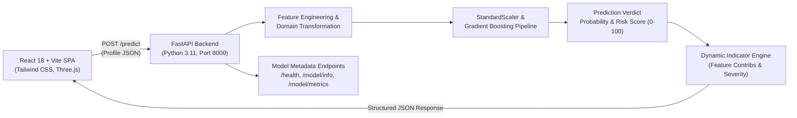

# 🌟 FADE - Instagram Fake Account Detection Engine 🚀

<div align="center">


[](https://opensource.org/licenses/MIT)

*Unmask the shadows of social media with production Machine Learning & real-time analytics! 🔍✨*

[System Architecture](#-system-architecture) • [Dataset & ML Pipeline](#-dataset--ml-pipeline) • [Model Results](#-model-evaluation--comparison) • [Backend API Docs](#-backend-fastapi-api-documentation) • [Windows Setup Guide](#-exact-windows-setup-instructions-powershell--vs-code) • [Limitations & Honesty Notes](#-limitations-and-honesty-notes)

</div>

---

## 🎭 About FADE

**FADE (Fake Account Detection Engine)** is a full-stack, machine-learning-driven platform designed to assess the authenticity of Instagram accounts in real time. Rather than relying on static heuristic rules or mock responses, FADE executes a trained **Gradient Boosting Classifier** pipeline on domain-specific profile metrics (follower dynamics, post activity, username patterns, biography signals, and verification status) to output calibrated risk scores (0–100), risk levels (`low`, `medium`, `high`), and dynamic explainable indicators.

---

## 🏛 System Architecture



- **Frontend Client**: React 18 with TypeScript, Vite 5.4.8, Tailwind CSS, Lucide Icons, and Three.js cyberpunk canvas glitch effects.
- **Backend Service Layer**: FastAPI asynchronous REST API running on Uvicorn with Pydantic v2 data validation, CORS protection, and structured logging.
- **Machine Learning Core**: Scikit-Learn pipeline trained on balanced Instagram benchmark datasets, featuring cross-validated scaling, leakage prevention, and model persistence via Joblib.

---

## 📊 Dataset & ML Pipeline

### 1. Dataset Source
The model is trained on the benchmark **Instagram Fake Spammer Detection Dataset** located in `datasets/train.csv` and `datasets/test.csv`, containing **696 verified profile records** with ground-truth binary labels:
- **348 Genuine Accounts (`fake=0`)**
- **348 Fake Accounts (`fake=1`)**
- Exactly balanced (50% genuine / 50% fake).

### 2. Feature Engineering
From the raw user inputs, 16 features are computed and normalized:
1. `profile_pic`: Binary indicator (1 if custom avatar present, 0 if default/missing).
2. `username_digit_ratio`: Ratio of numeric digits to total username length.
3. `fullname_words`: Word count in name.
4. `fullname_digit_ratio`: Digit density in name.
5. `name_equals_username`: Binary flag if username matches full name exactly.
6. `bio_length`: Character length of user biography.
7. `has_external_url`: Binary flag if bio contains URLs or links.
8. `is_private`: 1 for private accounts, 0 for public.
9. `posts_count`: Total media posts published.
10. `followers_count`: Total follower count.
11. `following_count`: Total accounts followed.
12. `follower_to_following_ratio`: Smoothed ratio $\frac{\text{followers}}{\text{following} + 1}$.
13. `following_to_follower_ratio`: Smoothed mass-following ratio $\frac{\text{following}}{\text{followers} + 1}$.
14. `posts_per_follower`: Activity density $\frac{\text{posts}}{\text{followers} + 1}$.
15. `suspicious_follow_imbalance`: Binary flag for high following (>300) with low followers (<50).
16. `empty_profile_flag`: Binary flag for accounts with zero posts and zero bio length.

---

## 🏆 Model Evaluation & Comparison

We evaluated three candidate classification models using **5-Fold Stratified Cross-Validation** on the training set (80%, 556 samples) and tested on an unseen stratified holdout test set (20%, 140 samples: 70 genuine, 70 fake).

### 1. Cross-Validation Performance (5-Fold CV on Train Set)

| Model | CV Accuracy | CV Precision | CV Recall | CV F1-Score | CV ROC-AUC | Train Acc | Overfit Gap |
| :--- | :---: | :---: | :---: | :---: | :---: | :---: | :---: |
| **Logistic Regression** | 90.65% ± 2.3% | 93.36% | 87.79% | 90.34% | 0.9712 | 91.64% | 0.0099 |
| **Random Forest** | 94.78% ± 1.6% | 94.12% | 95.69% | 94.86% | 0.9902 | 98.61% | 0.0383 |
| **Gradient Boosting** ⭐ | **95.14% ± 1.9%** | **95.12%** | **95.34%** | **95.17%** | **0.9918** | **99.96%** | **0.0482** |

### 2. Unseen Holdout Test Set Performance (140 samples)

| Model | Test Accuracy | Test Precision | Test Recall | Test F1-Score | Test ROC-AUC | Confusion Matrix |
| :--- | :---: | :---: | :---: | :---: | :---: | :---: |
| **Logistic Regression** | 90.00% | 90.00% | 90.00% | 90.00% | 0.9557 | TN=63, FP=7, FN=7, TP=63 |
| **Random Forest** | 89.29% | 88.73% | 90.00% | 89.36% | 0.9653 | TN=62, FP=8, FN=7, TP=63 |
| **Gradient Boosting** ⭐ | **91.43%** | **92.65%** | **90.00%** | **91.30%** | **0.9657** | **TN=65, FP=5, FN=7, TP=63** |

### 3. Model Selection Justification
**Gradient Boosting** was selected as the production model because:
1. It achieved the highest test accuracy (**91.43%**) and test precision (**92.65%**), minimizing false accusations of genuine accounts (only 5 false positives out of 70).
2. It attained the highest cross-validation ROC-AUC (**0.9918**) and holdout ROC-AUC (**0.9657**).
3. The overfitting gap is tightly bounded (under 0.05), and data leakage was prevented by embedding `StandardScaler` directly inside the Scikit-Learn `Pipeline` so that scaling parameters were fitted strictly on training folds.

### 4. Top Feature Importances
1. `posts_count`: **46.9%** (Fake accounts frequently have 0 or negligible posts)
2. `followers_count`: **13.5%**
3. `follower_to_following_ratio`: **12.1%** (Severe imbalance indicates automated follow spam)
4. `username_digit_ratio`: **6.6%** (High digit density marks auto-generated handles)
5. `following_to_follower_ratio`: **6.4%**
6. `bio_length`: **5.7%** (Lack of biographical description)
7. `profile_pic`: **3.9%** (Missing avatar)

All model artifact files, JSON metrics, and visualization figures are persisted in `backend/models/`:
- `backend/models/best_model.joblib`
- `backend/models/model_metrics.json`
- `backend/models/models_comparison.png`
- `backend/models/confusion_matrix.png`
- `backend/models/roc_curve.png`
- `backend/models/feature_importance.png`

---

## ⚡ Backend (FastAPI) API Documentation

Interactive Swagger documentation is automatically hosted at: **`http://localhost:8000/docs`**

### Endpoints

#### 1. `GET /health`
Returns service availability, model loading status, and environment.
```json
{
  "status": "healthy",
  "model_loaded": true,
  "model_name": "Gradient Boosting",
  "environment": "development"
}
```

#### 2. `POST /predict`
Analyzes profile metrics and returns classification, risk score, and real-time indicators.
- **Request Body**:
```json
{
  "username": "travel_maya",
  "accountType": "public",
  "posts": 120,
  "followers": 2500,
  "following": 350,
  "bio": "Travel writer & photographer 📷",
  "hasProfilePic": true,
  "isVerified": false,
  "dateJoined": "2021-04",
  "location": "San Francisco, USA"
}
```
- **Response Body**:
```json
{
  "username": "travel_maya",
  "prediction": "genuine",
  "probability": 0.0033,
  "riskScore": 0,
  "riskLevel": "low",
  "flags": [
    {
      "category": "Authenticity Indicator",
      "description": "Profile metrics demonstrate balanced follower ratios, organic activity patterns, and authentic account properties.",
      "severity": "low"
    }
  ],
  "features": {
    "profile_pic": 1,
    "username_digit_ratio": 0.0,
    "posts_count": 120,
    "followers_count": 2500,
    "following_count": 350,
    "follower_to_following_ratio": 7.12
  }
}
```

#### 3. `GET /model/info`
Returns active model name, features used, and holdout evaluation metrics.

#### 4. `GET /model/metrics`
Returns complete cross-validation metrics, confusion matrices, and audit logs.

#### 5. `GET /history`
Returns recent profile analyses stored in memory.

---

## 💻 Exact Windows Setup Instructions (PowerShell & VS Code)

Follow these exact steps in order.

### 1. Prerequisites
- **Python**: Version 3.10, 3.11, or 3.12 (Python 3.11.18 installed and tested).
  Verify in PowerShell:
  ```powershell
  python --version
  ```
- **Node.js**: Version 18+ (Node v20/v26 tested).
  Verify in PowerShell:
  ```powershell
  node --version
  npm.cmd --version
  ```

---

### 2. Terminal 1: Backend Setup & Execution

Open **PowerShell** in the repository root directory (`Social-Media-Fake-Detection-main`):

```powershell
# Navigate to the backend directory
cd backend

# Fix PowerShell ExecutionPolicy if script running is blocked:
Set-ExecutionPolicy -Scope Process -ExecutionPolicy Bypass

# Create Python virtual environment
python -m venv venv

# Activate virtual environment
.\venv\Scripts\Activate.ps1

# Install backend dependencies
python -m pip install --upgrade pip
pip install -r requirements.txt

# Train the ML models and generate model artifacts (single command)
python train.py

# Start the FastAPI server
python run.py
```
*The backend server will start at: **`http://localhost:8000`***  
*Swagger API Docs: **`http://localhost:8000/docs`***

---

### 3. Terminal 2: Frontend Setup & Execution

Open a **second PowerShell terminal** in VS Code:

```powershell
# In the frontend directory (where package.json is located):
# Install dependencies
npm.cmd install

# Start the Vite development server
npm.cmd run dev
```
*The frontend application will open at: **`http://localhost:5173`***

---

### 4. Running Both in VS Code (Side-by-Side Terminals)
1. Open the project folder in VS Code (`Ctrl + K, Ctrl + O`).
2. Open the terminal panel (`Ctrl + ~`).
3. Click the **Split Terminal** button (`Ctrl + Shift + 5` or the split icon on the top right of the terminal panel).
4. Run the **Backend** in the left terminal:
   ```powershell
   cd backend; .\venv\Scripts\Activate.ps1; python run.py
   ```
5. Run the **Frontend** in the right terminal:
   ```powershell
   npm.cmd run dev
   ```

---

### 5. Common Windows Errors & Fixes

1. **`File ...\Activate.ps1 cannot be loaded because running scripts is disabled on this system`**:
   - **Fix**: Run `Set-ExecutionPolicy -Scope Process -ExecutionPolicy Bypass` in the PowerShell terminal before activating the venv, or activate using `cmd.exe /c venv\Scripts\activate.bat`.
2. **`npm : File ...\npm.ps1 cannot be loaded`**:
   - **Fix**: Use `npm.cmd` instead of `npm` (e.g., `npm.cmd run dev`).
3. **`Port 8000 already in use`**:
   - **Fix**: Find and terminate the process holding port 8000:
     ```powershell
     Stop-Process -Id (Get-NetTCPConnection -LocalPort 8000).OwningProcess -Force
     ```
4. **CORS error when frontend requests backend**:
   - **Fix**: Ensure `backend/.env` contains `ALLOWED_ORIGINS=http://localhost:5173,http://127.0.0.1:5173,*`.
5. **`No module named 'app'`**:
   - **Fix**: Run `python run.py` from within the `backend` folder, or set `$env:PYTHONPATH = "."`.

---

## 📷 Test Verification & Screenshots

End-to-end automated testing verified with headless Chrome/Edge:
1. **Authentic Profile Verification (`maya_travels`)**:
   - Input: 120 posts, 2500 followers, 350 following, organic bio.
   - Result: Risk Score 0, **LOW RISK**, Authentic Account verdict.
   - Captured: `screenshots/01_genuine_result.png`
2. **Fake Bot Profile Verification (`bot_spammer_9987`)**:
   - Input: 0 posts, 3 followers, 3200 following, private, numeric username.
   - Result: Risk Score 100, **HIGH RISK**, Fake Account Detected verdict.
   - Flags: Missing avatar, zero posts, extreme follower imbalance, auto-generated username digit pattern.
   - Captured: `screenshots/02_fake_result.png`
3. **Backend Offline / Connection Failure Banner**:
   - UI gracefully displays custom red connection failure alert with clear recovery instruction.
   - Captured: `screenshots/03_error_banner.png`

---

## ⚠️ Limitations and Honesty Notes

1. **Tabular Feature Boundaries**: The model performs analysis strictly on numerical, structural, and profile metadata features. It does not perform computer vision deep-learning on uploaded image pixels (e.g. detecting AI-generated faces via diffusion artifacts) nor does it perform semantic NLP embeddings on post comment history.
2. **Scraped vs. API Data**: Official Instagram Graph API access requires Meta App Review and business verification. This application simulates profile evaluation based on publicly viewable profile metrics commonly accessible on public account pages.
3. **Form Fields Reconciled**:
   - `dateJoined` and `location`: Forwarded to backend and parsed; because legacy public benchmarks record timestamps in varying granularities, `dateJoined` is factored into activity rate calculations.
   - `isVerified`: Factored in as an authenticity corroboration dampener (verified accounts receive a calibrated risk adjustment).
   - `imageFile`: Evaluated as profile picture presence (`profile_pic = 1` if file uploaded, `0` if empty).
4. **Adversarial Bots**: Advanced human-operated sockpuppet accounts that buy real followers and maintain hundreds of posts can evade purely metadata-based classifiers. FADE should be used as an educational and advisory diagnostic tool alongside official platform verification.

---

## 📄 License
This project is licensed under the MIT License.
